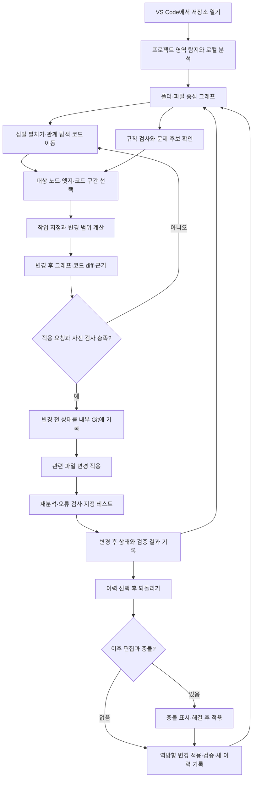
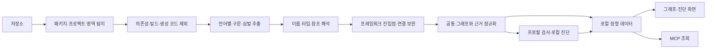
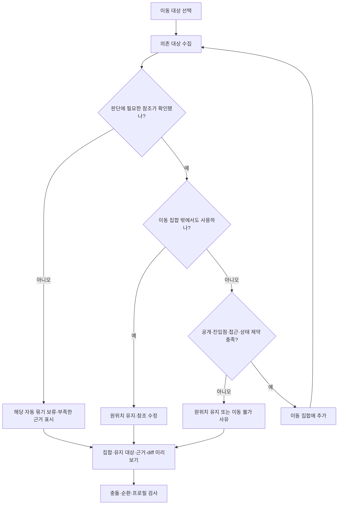
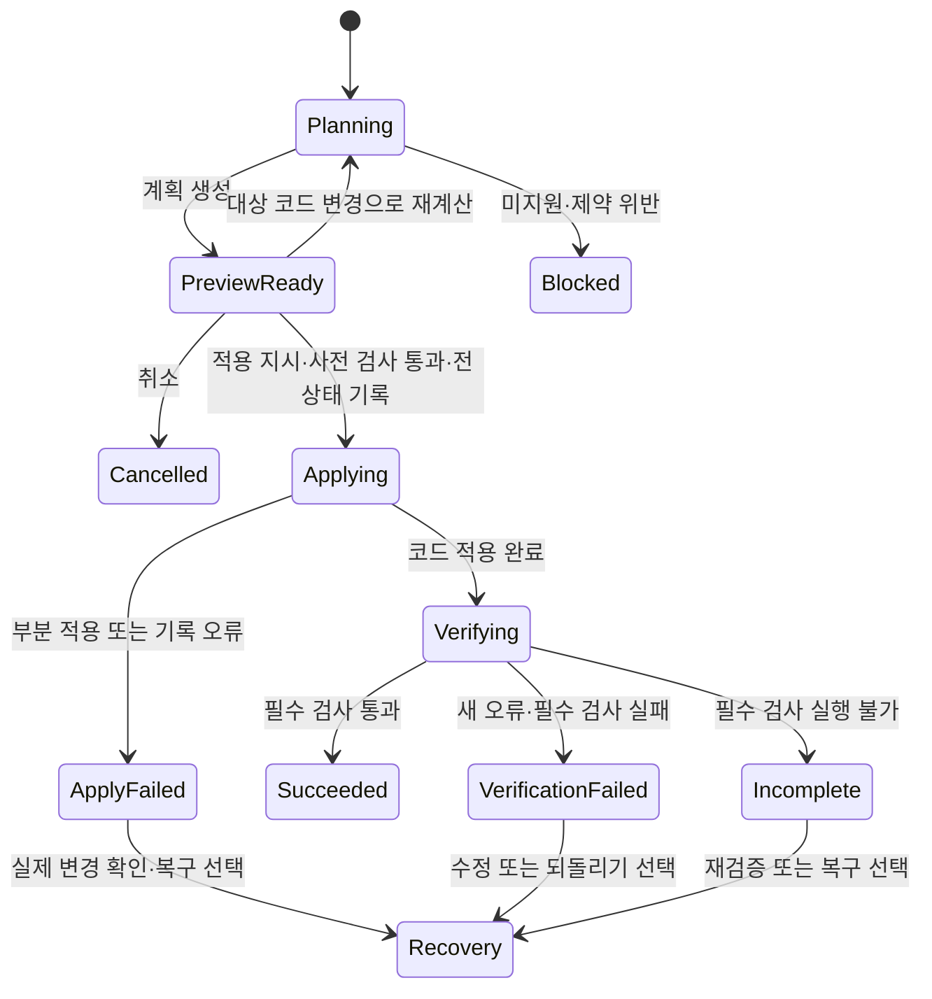
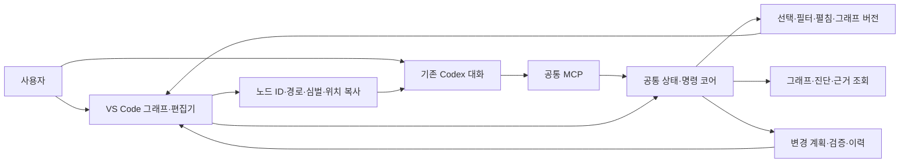
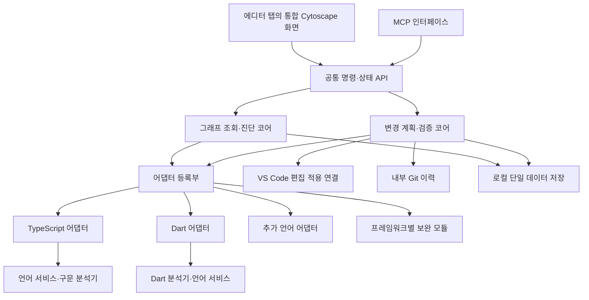
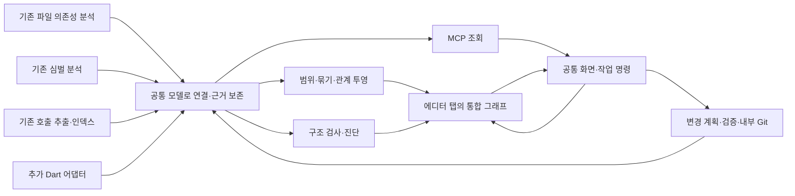

# 코드 구조 탐색·리팩토링 VS Code 확장 설계

- 문서 상태: 인터뷰 합의에 따른 제품·기술 설계 초안
- 작성일: 2026-11-01 (Asia/Seoul)
- 개정: 통합 그래프 화면·분석 재사용·단계별 코드 작성 계획 반영
- 제품명: Structure Graph (가칭)
- 구현 상태: 구현·포크·prune 전. 기존 후보 소스 조사까지 수행했으며 실행 검증은 미수행.
- 문서 해석: ‘확정’은 요구사항 합의이며 구현 완료를 뜻하지 않는다. ‘제안’과 ‘미검증’은 구현 전에 확인할 선택이다.

## 목차

1. 제품 목표와 범위
2. 대표 작업과 전체 흐름
3. 화면 구성과 탐색
4. 분석·증분 갱신
5. 데이터 모델과 로컬 저장
6. 구조 프로필·문서 책임
7. 구조 진단
8. 리팩토링 계획·적용·검증
9. 내부 Git 이력·되돌리기
10. MCP와 에이전트 공동 조작
11. 아키텍처와 언어 확장
12. 기반 프로젝트와 prune
13. MVP 수용 기준·개발 순서
14. 미결정 사항과 기술 검증
15. 설계 결정 기록

## 1. 제품 목표와 범위

### 1.1 해결할 문제

에이전트가 만든 코드를 사용자가 충분히 이해하지 못한 채 국소적인 수정을 반복하면 중복 구현, 책임 혼재, 잘못된 기능 배치, 과도한 추상화와 의존성 문제가 누적된다. 본 제품은 실제 코드 구조와 참조 관계를 사람이 탐색하고, 명시적인 구조 기준 아래에서 코드를 재구성하고 검증하는 도구다.

우선순위는 **리팩토링 → 온보딩 → 변경 후 검토 → 변경 전 이해**다. 시각화는 구조를 판단하고 실제 코드 변경으로 연결하는 작업 인터페이스다.

### 1.2 확정 범위

- 제품 형태는 VS Code 확장이다.
- 첫 검증 언어는 Dart와 TypeScript이며, 다른 언어를 추가할 수 있게 설계한다.
- 첫 적용 사례는 `sjh354/ggultarae`의 Dart 앱과 TypeScript 서버다. 현재 규모·구성은 구현 시점에 다시 조사한다.
- 폴더·파일·클래스·함수와 호출·참조를 탐색하고 코드 위치로 이동한다.
- 이동, 이름 변경, 함수 추출, 인라인을 제공한다. 언어·대상별 실제 지원 조건을 표시한다.
- 책임 분리, 중복 통합, 기능 배치, 과도한 추상화, 의존성 개선의 다섯 진단 영역을 포함한다.
- 기본 분석은 로컬에서 수행하며 자동 LLM 호출은 하지 않는다.
- 사람과 외부 에이전트는 같은 그래프 상태와 작업 명령을 사용한다. 첫 검증 에이전트는 Codex다.
- 설정·분석은 로컬 전용 단일 정형 파일, 변경 이력은 별도 내부 Git 저장소에 보관한다.

### 1.3 첫 버전 제외 범위

- 모의 입력 생성, 앱·서버의 실제 요청 실행과 동적 실행 추적
- 미래 모듈 구조를 자유롭게 설계하는 전용 편집 모드
- 여러 독립적인 리팩토링의 예약·일괄 적용
- 도구 이력의 브랜치·병합 UI, 팀 동기화, 원격 이력 저장
- 확장 안의 AI 채팅, Codex 전용 검토 버튼, 자체 에이전트 실행기
- 모든 언어에서 동일한 수준의 분석·변경 기능을 제공한다는 보장

## 2. 대표 작업과 전체 흐름

사용자는 저장소를 열고 전체 구조를 확인한 후 관련 부분을 펼친다. 진단이나 직접 탐색으로 변경 대상을 고르고, 작업과 대상 위치를 지정한다. 도구가 변경 범위와 근거를 계산하고 구조 변화와 코드 diff를 보여준다. 적용 후에는 분석과 검사를 다시 실행하고 결과를 이력에 남긴다.



첫 분석 시 프로필이 없으면 현재 구조를 탐색할 수 있다. 목표 구조 기준은 영역별로 선택·확정한 뒤 적용하며, 프로필 선택 자체가 코드를 바꾸지는 않는다. 문서·코드에서 얻은 구조 제안은 승인된 기준과 구분한다.

## 3. 화면 구성과 탐색

### 3.1 진입점과 화면 배치

Live Call Graph의 Cytoscape 기반 화면을 중심으로 통합한다. File Graph·Symbol View·Architecture View는 독립 화면으로 영구 유지하기보다 같은 화면에서 표시 수준과 관계 종류를 전환하는 기능으로 수렴한다. 기존 분석기는 화면 통합과 별개로 보존한다.

- 에디터 제목 영역의 그래프 아이콘에서 일반 에디터 탭으로 연다. 하단 패널을 기본 위치로 강제하지 않는다.
- `editor/title` 명령과 `WebviewPanel`을 연결하며 현재 코드의 심벌을 시작점으로 삼을 수 있다.
- 심벌을 특정할 수 없으면 현재 파일·영역에서 시작한다. 프로젝트 전체 구조는 별도로 선택할 수 있다.
- 코드와 그래프를 나란히 분할할 수 있다. 같은 프로젝트의 분석 세션을 재사용하며 탭마다 중복 분석기를 만들지 않는다.
- 처음에는 폴더·파일 단위 묶음으로 보고 펼치면 함수·클래스 등 심벌이 나타난다.
- 상단에는 영역·검색·관계 필터·묶기·진단 제어를 두고 오른쪽에는 선택 대상 상세를 둔다.
- 구조 보기와 흐름 보기는 동일한 식별자·선택 상태를 공유하는 표시 방식이다.
- 관계 수·표시량을 제한하면 숨긴 수와 실제 분석 범위를 구분해 표시한다.

### 3.2 원형 노드·조작·상세

함수·메서드·클래스 등 심벌은 기본적으로 이름 없는 원으로 표시한다. 폴더·파일 묶음에는 이름을 표시한다. 심벌 이름은 삭제하지 않고 상세·검색·접근성 정보에 유지한다.

| 조작 | 동작 |
|---|---|
| 심벌 원 클릭 | 선택·관계 강조·오른쪽 상세 표시. 자동 코드 이동과 그래프 재중심화는 하지 않음 |
| 코드 열기 버튼 또는 더블클릭 | 선언 위치로 이동 |
| 엣지 클릭 | 관계 근거와 호출·참조 위치 목록 표시. 위치를 선택하면 코드 이동 |
| 중심으로 보기 명령 | 명시적으로 선택 심벌 주변을 조회하고 재중심화 |
| 원 드래그 | 화면 위치만 변경. 코드 이동과 구분 |
| 파일·폴더 펼치기 | 해당 묶음의 하위 요소 표시. 나머지 선택·수동 배치 유지 |
| 참조 복사 | 프로젝트·노드 ID·경로·심벌·위치·분석 버전 복사 |

상세에는 심벌 이름·종류·언어·경로·코드 위치, 호출·참조, 진단·불확실성, 사용 가능한 변경 명령을 표시한다. 여러 위치를 하나의 엣지로 집계해도 개별 근거는 보존한다.

렌더링은 기존 Cytoscape.js와 fCoSE를 우선 활용한다. 드래그·줌·팬·복합 노드 기능을 재사용하고, 기본 심벌 스타일을 원형·무라벨로 수정한다. 자동 배치는 계산 후 안정적으로 멈춘다. 지속적인 물리 시뮬레이션은 MVP 요구가 아니다.

저장·필터·부분 펼침 때 전체 배치를 무작위로 다시 만들지 않는다. 기존 위치와 고정 상태를 유지하고 새 노드를 주변에 배치한다. 전체 재배치는 명시적 명령으로 제공한다. 구현 가능성과 대규모 그래프 응답성은 실제 UI로 검증한다.

### 3.3 선택적 접기

자동 접기는 기본적으로 꺼져 있다. 옵션을 켜면 단일 호출자의 내부 구현을 그 호출자 안에 접어 표시할 수 있다. 공개 심벌·프레임워크 진입점·참조 정보가 불완전한 심벌은 자동 접기에서 제외한다. 순환 호출은 별도 묶음으로 표현한다.

접힌 함수의 외부 연결은 누락하지 않고 집계해 표시하며 언제든 펼칠 수 있다. 접기와 코드 인라인은 서로 다른 기능이다. 단일 호출자는 불필요한 추상화의 확정 판정이 아니다.

## 4. 분석·증분 갱신

### 4.1 분석 단계



구문 분석, 의미 해석, 프레임워크 보완은 서로 다른 책임이다. Tree-sitter 추출만으로 타입과 실제 참조가 모두 해석된다고 가정하지 않는다. 이름이 같다는 이유만으로 연결을 확정하지 않는다.

### 4.2 분석 범위

저장소 전체를 기본으로 분석하되 Dart 패키지·TypeScript 프로젝트 등의 영역 경계를 탐지한다. 영역별 프로필과 필터를 제공한다. 빌드 결과·의존성·자동 생성 코드는 기본 제외하되 제외 설정을 변경할 수 있다.

제외된 파일로 인해 참조 확인이 제한되면 해당 심벌의 분석 범위에도 한계를 기록한다. 참조가 발견되지 않았다는 사실과 다른 참조가 없다고 확인한 결과를 구분한다.

### 4.3 갱신

- 파일 저장 시 변경 파일과 영향받는 관계·진단을 증분 갱신한다.
- 도구의 리팩토링 적용 후에는 변경 파일을 즉시 재분석한다.
- 저장하지 않은 편집이 있으면 그래프가 저장된 코드 기준임을 표시한다.
- 파일 추가·삭제·이동, 프로젝트 설정·의존성·분석기 버전 변경도 무효화 조건에 포함한다.
- 전체 재분석 명령을 제공한다.
- 재분석 중 결과의 버전과 최신 여부를 구분하며 불완전한 결과를 최신 확정 결과로 대체하지 않는다.

## 5. 데이터 모델과 로컬 저장

### 5.1 공통 모델

| 엔터티 | 핵심 정보 |
|---|---|
| 프로젝트·영역 | 저장소 식별, 영역 루트, 언어·프로젝트 설정, 프로필 |
| 코드 노드 | 식별자, 언어, 심벌 종류, 이름, 파일·선언 범위, 소속 |
| 관계 | 호출·참조·상속·구현 등 관계 종류, 출발·도착 심벌, 발생 위치 목록 |
| 분석 근거 | 분석기·버전, 구문/의미/프레임워크 출처, 확인·추정·미해결 상태 |
| 분석 범위 | 검사한 영역, 제외 경로, 실패·미지원 항목, 최신성 |
| 진단 | 규칙·버전, 대상과 근거, 확정 위반/검토 후보, 현재 상태 |
| 프로필·예외 | 책임과 경계, 허용 의존성, 승인된 예외의 이유·범위 |
| 변경 계획 | 작업, 기준 코드 버전, 변경 대상, 편집안, 구조 차이, 검사 결과 |
| 작업 이력 | 내부 Git 기록 참조, 전후 경로, 적용·검증 상태, 원작업과 되돌리기 관계 |

소속 관계와 참조 관계를 분리한다. 같은 노드를 폴더·파일·기능 영역별로 묶어도 원래 식별을 유지한다. 경로·이름·줄 번호만으로 변경 전후 동일성을 완전히 보장할 수 없으므로 식별 및 재연결 방법은 기술 검증 항목이다. 오래된 ID는 임의의 다른 심벌로 대체하지 않는다.

### 5.2 로컬 파일 배치

다음 이름은 제품명 확정 전의 예시다.

```text
<workspace>/
  .<product>/
    state.json       # 설정·예외·분석 결과·진단·스키마 버전
    history/         # 도구 전용 Git 저장소와 이력 관리 메타데이터
```

설정·분석 결과의 영구 원본은 단일 정형 파일로 둔다. JSON은 우선 후보이며 대규모 그래프 성능을 검증한다. 내부 계산에 인메모리 인덱스나 SQLite를 쓰는 것은 영구 저장 형식과 별개다.

- 재분석은 사용자가 확정한 설정·프로필·예외를 보존한다.
- 스키마·분석기별 버전과 코드 지문을 기록한다.
- 임시 파일을 이용한 안전한 교체와 복구 가능한 형식 전환을 설계한다.
- MCP와 UI는 공통 코어를 통해 접근한다. 여러 프로세스가 파일을 독립적으로 덮어쓰지 않게 한다.
- 숨김 폴더 전체는 Git 추적에서 제외한다. 로컬 제외 설정 등 사용자 저장소의 공유 파일을 불필요하게 바꾸지 않는 방법을 우선 검토한다.
- 다른 환경에서 처음 열면 분석과 프로필 설정을 새로 진행한다.

## 6. 구조 프로필·문서 책임

### 6.1 영역별 구조 프로필

프로젝트 도입 시 현재 코드·기존 문서를 분석해 구조 후보와 차이를 보여준다. 사용자가 영역별로 목표 프로필을 선택·확정한다. 기존 코드와 문서는 근거이며 자동으로 정답이 되지 않는다. 충돌은 근거와 함께 드러낸다.

프로필은 책임 배치, 경로 규칙, 허용 의존 방향, 공통 기능 위치·추출 기준과 경계를 정의한다. 계층형, 기능 중심 모듈, Ports & Adapters 등을 후보로 검토한다. 상호 배타적이지 않은 방법론은 조합 가능한 프로필로 표현한다. 제공할 구체적인 프로필 목록은 미확정이다.

- 저장소 전체에 하나의 폴더 구조를 강제하지 않는다.
- 영역별 프로필과 영역 사이의 연결 규칙을 관리한다.
- 기존 위반은 기준선으로 기록한다.
- 새로 생기거나 악화되는 위반은 기본 적용을 차단한다.
- 사용자가 이유·범위를 지정한 예외는 기록 후 허용한다.
- 불확실한 관계는 확정 위반으로 판정하지 않는다. 다만 변경 조건을 확인할 수 없으면 해당 변경을 보류할 수 있다.

### 6.2 문서별 단일 책임

| 위치 | 원본으로 관리할 내용 |
|---|---|
| README.md | 제품 소개, 준비·설정·실행·검증 방법, 폴더 안내 |
| DESIGN.md | 제품 동작, 설계 결정, 책임·경계, 기술 선택과 이유 |
| `.agents/AGENTS.md` | 간결한 작업 규칙과 필요한 원본 참조 |
| 로컬 state 파일 | 정확한 프로필 설정·규칙·예외·분석 데이터 |
| 내부 Git | 변경 전후 파일 상태와 작업 이력 |

같은 규칙을 여러 문서에 복사해 독립적으로 관리하지 않는다. 예를 들어 정확한 허용 의존성은 설정 파일이 소유하고, DESIGN은 그 선택 이유를 소유한다. 구조 프로필과 문서 템플릿은 우리 확장에 적용하고 분석 대상 프로젝트에도 도입 가능하게 한다. 기존 프로젝트 문서를 자동으로 재편하거나 덮어쓰지는 않는다. 의미적인 문서 충돌은 기본 로컬 분석이 모두 해결한다고 보장하지 않는다.

## 7. 구조 진단

다섯 영역을 MVP에 포함하되 기계적으로 확인한 위반과 검토 후보를 분리한다.

| 영역 | 초기 로컬 탐지 근거 | 해석의 한계 |
|---|---|---|
| 책임 집중 | 크기·복잡도·결합도·분리된 의존성 묶음 | 여러 업무 책임인지 의미 판단 필요 |
| 중복 구현 | 동일 코드·식별자 정규화 기반 유사성 | 다른 형태의 동일 업무 기능은 놓칠 수 있음 |
| 기능 배치 | 프로필의 경로·책임·의존성 규칙 | 의미적 기능 소속은 코드만으로 확정 불가 |
| 과도한 추상화 | 단순 전달·래퍼·단일 호출자 패턴 | 의도적인 경계나 확장점일 수 있음 |
| 의존성 문제 | 순환·금지 참조·과도한 결합 | 런타임 연결은 분석 범위 밖일 수 있음 |

모든 결과는 규칙, 적용 범위, 코드·관계 근거, 불확실성을 제공한다. 임계값과 중복 탐지 알고리즘은 구현 전 결정한다. 단일 종합 점수로 설계 품질을 확정하지 않는다. 진단은 코드를 자동 수정하지 않는다.

사용자는 참조를 복사해 외부 Codex 대화에서 의미 검토를 요청할 수 있다. 자동으로 LLM에 코드를 보내거나 검토를 시작하지 않는다.

## 8. 리팩토링 계획·적용·검증

### 8.1 작업별 시작점

| 작업 | 시작점 | 범위 |
|---|---|---|
| 이동 | 함수·클래스 노드와 대상 파일/새 경로 지정 | 대상과 규칙상 함께 이동할 내부 구현·참조 수정 |
| 이름 변경 | 노드 | 해석된 선언·참조의 이름 변경 |
| 함수 추출 | 편집기에서 코드 구간 선택 | 새 함수·인자·호출부 생성 |
| 인라인 | 호출 엣지 또는 함수 노드 | 특정 호출 또는 가능한 전체 호출의 미리보기 |

엣지가 여러 호출 위치를 집계하면 특정 호출을 고를 수 있어야 한다. 생성자·메서드·비동기·클로저 등 세부 조건은 언어 어댑터가 검사한다.

### 8.2 변경 구현 방식

언어 서비스가 지원하는 변경 기능을 우선 활용한다. 지원되지 않는 변경은 언어별 구현 또는 사용자가 요청한 외부 에이전트의 변경안으로 보완할 수 있다. 구현하지 못한 작업을 에이전트 호출로 자동 대체하지 않는다.

에이전트가 만든 코드도 도구의 변경 작업으로 적용하려면 공통 계획·검사·이력 경로를 거쳐야 한다. 에이전트가 도구 밖에서 직접 편집한 코드는 저장 후 재분석 대상이지만, 도구가 수행한 작업 이력으로 자동 편입되지는 않는다.

### 8.3 이동 묶음 계산

이동 범위는 에이전트가 임의로 묶지 않고 별도 규칙 엔진이 계산한다.

1. 선택한 심벌의 의존 대상을 구한다.
2. 후보의 모든 관련 사용처가 현재 이동 집합 내부인지 확인한다.
3. 공개 API·프레임워크 진입점·접근 제한·파일/라이브러리 상태 의존 등 제약을 검사한다.
4. 조건을 만족하는 내부 구현만 집합에 추가하고 더 이상 바뀌지 않을 때까지 반복한다.
5. 공유 구현은 남기고 참조·import를 수정한다.
6. 이동으로 순환 의존성·이름 충돌·규칙 위반이 생기는지 확인한다.

호출뿐 아니라 함수 값 전달·타입·상속·annotation·등록 등 관련 참조도 고려한다. 순환 집합을 개별 심벌처럼 이동하지 않는다. Dart의 라이브러리 단위 private·part 관계와 TypeScript의 export·재수출·모듈 해석은 각 어댑터가 검사한다. 이것은 세부 구현 검증이 필요한 조건이며 현재 구현된 기능이 아니다.



### 8.4 적용 상태와 실패



한 번에 하나의 변경 작업만 처리한다. 필요한 보조 함수와 import 수정은 같은 작업이다. 적용 직전에 파일 내용·존재·경로와 계획의 기준 버전을 확인한다. 미리보기 이후 코드가 달라졌으면 재계산한다. 변경 대상에 저장하지 않은 편집이 있으면 해결 전 적용하지 않는다.

적용 전 구조 위반을 검사하고, 적용 후에는 재분석과 언어별 오류 검사 및 프로젝트에 지정된 테스트 명령을 실행한다. 기존 오류와 새 오류를 구분하고 검사를 실행하지 못한 상태를 성공으로 기록하지 않는다.

검증 실패 시 자동 되돌리기는 하지 않는다. 원인·diff·결과를 남기고 수정 또는 되돌리기를 제공한다. 여러 파일의 적용이 항상 원자적이라고 가정하지 않는다. 부분 적용·프로세스 중단을 식별할 수 있는 작업 상태와 복구 정보를 남긴다.

## 9. 내부 Git 이력·되돌리기

### 9.1 범위와 격리

숨김 폴더 안의 전용 Git 저장소로 도구 작업의 전후 상태를 기록한다. 사용자의 저장소 브랜치·HEAD·인덱스·커밋과 분리하며 원격 push는 하지 않는다. 내부 저장소에는 도구가 변경하는 코드 파일의 상태만 기록하고 로컬 분석 파일이나 비밀 설정을 무차별 수집하지 않는다.

실제 디렉토리 구성과 Git 명령은 프로토타입으로 검증한다. 사용자 작업 트리에 내부 Git을 직접 연결할지, 별도 미러 작업 공간을 사용할지는 미결정이다. 어느 방식이든 사용자 Git에 영향을 주지 않아야 한다.

### 9.2 기록

- 작업 ID·종류·요청 주체·시점
- 변경 전후 파일 내용·경로·생성/삭제/이동
- 변경 계획·구조 차이·검증 상태
- 되돌리기/다시 적용 대상 작업과의 연결

하나의 사용자 작업을 하나의 이력 항목으로 표시한다. 전후 스냅샷을 Git 커밋에 어떻게 매핑할지는 내부 구현 사항이다. 변경 전 기록에 실패하면 코드 적용을 시작하지 않는다. 코드 적용 후 이력 기록에 실패하면 완료로 표시하지 않고 복구 가능 상태를 유지한다.

### 9.3 되돌리기와 다시 적용

기록된 전후 차이에서 역방향 변경을 만들어 현재 파일에 적용한다. 이후 사용자의 편집을 통째로 덮어쓰는 reset·checkout 방식으로 복구하지 않는다. 파일 이동·삭제·재생성과 바이너리·권한·심볼릭 링크 등 지원 범위도 명확히 정의한다.

충돌 시 위치와 차이를 보여주고 해결한 뒤 적용한다. 되돌리기도 검사와 새 이력 기록을 거친다. 다시 적용은 기록된 원변경을 현재 상태에 재적용하며 같은 충돌 절차를 따른다. 첫 버전 이력은 선형이며 브랜치 UI는 없다.

이력 용량 제한·보존·정리 정책은 미결정이다. 사용자에게 알리지 않고 복구에 필요한 기록을 삭제하지 않는다.

## 10. MCP와 에이전트 공동 조작

Codex 전용 화면·검토 버튼·채팅을 추가하지 않는다. 공통 MCP에 상태·조회·조작·변경 명령을 노출하고, 사용자는 평소 Codex 대화에서 작업한다.



### 10.1 기능 계약

명령명은 미확정이며 다음 기능을 제공한다.

- 현재 프로젝트·그래프 버전·선택·표시 범위·필터 조회
- 노드·관계·진단·분석 근거·미해결 정보 조회
- 선택·검색·펼침·접기·필터·코드 이동
- 변경 계획 생성·조회·취소·적용·검증 결과 조회
- 이력 조회·되돌리기·다시 적용

노드 ID는 프로젝트와 그래프 버전에 연결한다. 오래된 참조나 여러 프로젝트의 참조를 혼동하지 않는다. 큰 조회 결과는 범위·개수·페이지를 제한하고 누락 여부를 표시한다.

### 10.2 제어 원칙

- 사람과 에이전트는 동일한 규칙 엔진·작업 큐를 사용한다.
- 적용은 사용자 버튼 또는 대화에서의 적용 지시가 있을 때 수행한다. 도구의 계획 생성만으로 적용을 승인한 것으로 간주하지 않는다.
- 사용자가 조작하면 진행 중인 에이전트의 자동 화면 이동을 중단하고 사용자 상태를 우선한다.
- 분석·검증 같은 백그라운드 처리는 화면 조작과 분리한다.
- MCP의 전송·프로세스 연결은 기존 기반을 우선 재사용한다. 연결된 별도 MCP 프로세스가 현재 확장의 실제 상태를 보도록 하는 최소 브리지는 검증이 필요하다.
- 파일을 직접 읽는 별도 그래프 인덱스만 제공하고 ‘같은 화면을 본다’고 표현하지 않는다.

## 11. 아키텍처와 언어 확장



### 11.1 경계

공통 코어는 언어별 구문 노드나 VS Code 객체에 직접 의존하지 않는다. 언어 어댑터는 파일 인식, 분석, 참조 해석, 변경 기능과 검증을 담당한다. 프레임워크 보완은 언어 문법 지원과 분리한다. UI·MCP는 언어별 조건문을 직접 갖기보다 코어가 반환하는 기능·제약을 표시한다.

첫 버전은 저장소 내부 등록 방식으로 충분하다. 외부 플러그인 마켓이나 임의 코드 로딩 체계는 만들지 않는다.

### 11.2 기능별 지원 선언

‘언어 지원 여부’ 하나 대신 구조 추출·참조 해석·호출 분석·이름 변경·추출·인라인·이동·검증을 각각 선언한다. 실행 시 대상과 코드 구간에 대한 사전 조건도 확인한다. 단순 지원 플래그만으로 모든 대상에서 작업 가능하다고 판단하지 않는다.

분석기는 Tree-sitter, LSP, 언어별 컴파일러·분석기 등 여러 수단을 조합할 수 있다. LSP만으로 모든 기능이 제공된다고 가정하지 않는다. 느린 분석은 취소·시간 제한과 결과 불완전 상태를 지원한다.

### 11.3 언어 간 관계

Dart HTTP 요청과 TypeScript endpoint 연결은 함수의 직접 호출과 구분한 계약 관계다. 기본 언어 지원이 있다고 자동으로 연결하지 않는다. API 계약·문자열 경로·프레임워크 근거가 필요하며 첫 버전에서 자동 연결할 범위는 미검증이다. 실제 실행 경로는 이후 실행 추적 단계에서 별도로 연결한다.

### 11.4 기존 분석 경로의 통합과 보존

Analysis layer는 별도 네 번째 화면이 아니라 각 보기의 데이터를 생성하는 분석 방식이다. 분석 결과를 공통 모델로 연결하고 화면 투영 단계에서 파일·폴더·심벌 수준을 선택한다. 함수 호출 집계로 import 관계를 대체하지 않는다.

| 기존 경로 | 유지할 코드·역할 | 공통 모델에 제공할 정보 |
|---|---|---|
| File Graph | Spider·언어별 import 파서·경로 해석·역참조 인덱스 | 파일 의존성·import 근거·영역 구조 |
| Symbol View | ts-morph 기반 SymbolAnalyzer·Python/Rust 전용 분석기 | 파일 내부 심벌과 상세 관계·정밀 분석 보완 |
| Live Call Graph | GraphExtractor·언어별 scm·CallGraphIndexer·주변 조회 | 파일 간 심벌 관계·소속·호출 위치 |
| Architecture View | 집계·구조 규칙·기준선·순환 검사 | 폴더/영역 관계·구조 위반 근거 |



최초에는 기존 서비스 앞에 얇은 변환 계층을 둔다. 중복 추출이나 결과 충돌은 출처별로 관찰하고, 동일한 근거만 합친다. 서로 다른 분석기의 주장을 조용히 덮어쓰지 않는다. 기존 인덱스는 조회 가속에 재사용할 수 있으나 영구 설정·분석 원본은 5장의 단일 파일 정책을 따른다.

### 11.5 기존 언어 지원의 재사용

| 언어 | 파일 의존성 | 기존 Symbol View 경로 | Live Call Graph 경로 |
|---|---|---|---|
| TypeScript·JavaScript | import 추출·경로 해석 | ts-morph | Tree-sitter와 TypeScript 쿼리·import 연결 |
| Vue·Svelte | 스크립트 영역 기반 import 분석 | 개별 구문·템플릿 지원 범위 확인 필요 | 스크립트 추출 후 TS 계열 분석 |
| Python | 전용 import 파서 | 전용 심벌 분석기 | Python 쿼리·import 연결 |
| Rust | 전용 import 파서 | 전용 심벌 분석기 | Rust 쿼리·모듈/타입 연결 |
| C#·Go·Java | 각 언어의 import·경로 파서 | 전용 경로 없음 | 언어별 쿼리·타입/패키지 한정 호출 연결 |

이 표는 조사한 경로의 존재를 뜻하며 분석 정확도나 완전성을 보장하지 않는다. C#·Go·Java에 예전 Symbol View 분석기를 새로 만드는 대신 기존 호출 그래프 심벌을 상세 화면에 활용한다. 부족한 의미 정보는 해당 어댑터로 보완한다.

Tree-sitter WASM 로딩·scm 쿼리·Go 패키지/Rust 모듈/Java·C# 타입 한정 호출·언어별 테스트는 유지한다. Vue·Svelte의 스크립트 분석을 전체 템플릿 동작 해석으로 표현하지 않는다. 기존 언어는 탐색 기능을 보존하고 리팩토링 지원은 기능별 선언으로 구분한다.

### 11.6 저장소 구조 제안


기반 프로젝트의 기존 구조를 우선 활용하면서 코어·언어·프레임워크·VS Code·MCP·화면·저장·이력의 책임을 분리한다. 이 경계를 확보하기 위한 최소 정리만 수행하며, 폴더 이름을 맞추기 위한 전면 재작성은 하지 않는다. 확장 자체의 구체적인 구조 프로필은 기반 실행 검증 후 확정한다.

## 12. 기반 프로젝트와 prune

### 12.1 선정

Graph-It-Live를 기반 후보로 채택하고 최소 동작 검증 후 포크·prune 범위를 확정한다. VS Code 그래프·파일/심벌/호출 보기·구조 규칙·기존 위반 기준선·MCP가 이미 있어 재사용 가능성이 높다.

최초 조사 커밋: `70b9aa90d557a0d80e291a184d041b2f24844323`. 통합 UI·언어 분석 경로 추가 조사 커밋: `fd125feff1630b3fd677c0fc5d44fc1710af98b2`. 기준 커밋은 `d64fa72`(2026-11-01)로 고정했다. 빌드·타입 검사·유닛 테스트 4,274개·확장 호스트 실행·MCP 도구 22개를 확인했고, 아래 제거 후보는 모두 실행했다. Marketplace 설치 버전과 저장소 main의 일치를 가정하지 않는다. 현재 조사 결과는 소스 검토이며 실행 성능이나 정확도 보증이 아니다.

### 12.2 보존·변경·제거

| 구분 | 대상 |
|---|---|
| 보존 | 확장 골격, 그래프와 코드 연결, 기존 언어 모듈·쿼리·테스트, 공통 분석, 구조 규칙·순환 검사, 증분 처리, MCP 전송 |
| 수정 | Live Call Graph 중심 에디터 탭·원형 무라벨·클릭 상세·배치 보존, 언어별 분기의 어댑터 분리, 미해결 참조 보존, 관계 근거, 공유 화면 상태, 단일 영구 데이터 저장 |
| 추가 | Dart 연결, 실제 변경 계획·적용·검증, 규칙 기반 이동 묶음, 내부 Git 이력, 다섯 진단 영역의 부족한 기능 |
| 제거 완료 | 다른 에이전트 전용 패키지·마켓플레이스, Copilot 전용 등록, 위키 생성, 독립 CLI, Review Gate(`review-pr`), Branch Watch, CI 통합(릴리스·npm 배포·Pages·리뷰게이트), 사이트·미디어 |

기존 언어를 일괄 삭제하지 않는다. 예전 렌더러는 통합 화면의 기능 대체가 검증된 뒤에만 제거한다. ReactFlow·vis-network 등 의존성도 남은 화면·테스트의 사용 여부를 먼저 확인한다. 제거 후보도 공용 기능 의존성을 확인한 뒤 단위별로 제거한다. 원본 테스트 기준을 먼저 확보한다.

### 12.3 조사에서 발견한 제약

일부 미해결 참조는 이름·경로 유사성으로 연결되며 끝내 해결하지 못한 참조가 삭제되는 경로가 있다. 이를 자동 이동의 근거로 그대로 사용하지 않는다. 기존 MCP는 분석 중심이며 현재 UI 상태 공동 조작은 추가 구현이 필요하다. 원본의 SQLite·설정·기준선 파일 구성은 합의한 영구 저장 구조와 다르다.

라이선스는 MIT이며 원본 고지를 보존한다. 의존성·차용 코드의 개별 라이선스도 확인한다. Satori는 Apache-2.0이므로 코드를 실제 차용하면 해당 의무를 별도 확인한다.

### 12.4 참고 소스

추가 조사 기준:

- [에디터 진입점과 의존성](https://github.com/magic5644/Graph-It-Live/blob/fd125feff1630b3fd677c0fc5d44fc1710af98b2/package.json)
- [호출 그래프 화면·클릭·fCoSE](https://github.com/magic5644/Graph-It-Live/blob/fd125feff1630b3fd677c0fc5d44fc1710af98b2/src/webview/components/cytoscape/CytoscapeGraph.tsx)
- [호출 화면 연결 서비스](https://github.com/magic5644/Graph-It-Live/blob/fd125feff1630b3fd677c0fc5d44fc1710af98b2/src/extension/services/CallGraphViewService.ts)
- [심벌 화면 연결 서비스](https://github.com/magic5644/Graph-It-Live/blob/fd125feff1630b3fd677c0fc5d44fc1710af98b2/src/extension/services/SymbolViewService.ts)
- [언어별 분석기 등록](https://github.com/magic5644/Graph-It-Live/blob/fd125feff1630b3fd677c0fc5d44fc1710af98b2/src/analyzer/LanguageService.ts)
- [VS Code Webview](https://code.visualstudio.com/api/extension-guides/webview)

최초 조사 기준:

- [Graph-It-Live](https://github.com/magic5644/Graph-It-Live/tree/70b9aa90d557a0d80e291a184d041b2f24844323)
- [호출 그래프 추출기](https://github.com/magic5644/Graph-It-Live/blob/70b9aa90d557a0d80e291a184d041b2f24844323/src/analyzer/callgraph/GraphExtractor.ts)
- [참조 연결과 인덱스](https://github.com/magic5644/Graph-It-Live/blob/70b9aa90d557a0d80e291a184d041b2f24844323/src/analyzer/callgraph/CallGraphIndexer.ts)
- [구조 규칙](https://github.com/magic5644/Graph-It-Live/blob/70b9aa90d557a0d80e291a184d041b2f24844323/src/analyzer/architecture/architectureRules.ts)
- [MCP 도구](https://github.com/magic5644/Graph-It-Live/blob/70b9aa90d557a0d80e291a184d041b2f24844323/src/mcp/tools/index.ts)
- [Satori의 Dart 참조 분석](https://github.com/gearscrafter/satori/blob/fac97b52a25f6c49aa394659b4f351bd2fc4c571/src/lsp/reference_analysis.ts)
- [Satori 구조 프로필](https://github.com/gearscrafter/satori/blob/fac97b52a25f6c49aa394659b4f351bd2fc4c571/src/analysis/architecture_presets.ts)
- [code-review-graph 리팩토링](https://github.com/tirth8205/code-review-graph/blob/d72e8fbf7ef571b668c26a4222a284bf7792e7a1/code_review_graph/refactor.py)
- [CodeGraph Dart 추출](https://github.com/colbymchenry/codegraph/blob/0f93575c8393dcbae1dc7fbd32fa817ccf31f0c2/src/extraction/languages/dart.ts)
- [Graphify Dart 추출](https://github.com/Graphify-Labs/graphify/blob/a0946f962af31b19bff941b453f6dae9a7077c7a/graphify/extractors/dart.py)

## 13. MVP 수용 기준·개발 순서

### 13.1 완료 판단

| 영역 | 수용 기준 |
|---|---|
| 분석·표시 | Dart·TypeScript 영역을 구분하고 폴더·파일·심벌과 근거 있는 참조를 탐색 가능 |
| 코드 연결 | 클릭은 상세 표시, 코드 열기·더블클릭은 선언 이동. 엣지 상세에서 참조 위치 선택 가능 |
| UI | 제목 영역 버튼으로 에디터 탭 열기·분할, 원형 무라벨 심벌·폴더/파일 묶음·드래그·재분석 후 위치 보존 |
| 최신성 | 저장·추가·삭제·이동 후 갱신되며 저장 전 편집·실패·미해결 상태를 구분 |
| 변경 | 두 언어 각각에서 이름 변경·추출·인라인·이동의 지원 조건과 실제 검증 사례 확보 |
| 이동 범위 | 전용 보조 함수·공유 함수·공개 API·미해결 참조·순환 관계 사례에서 기대 범위를 계산 |
| 구조 규칙 | 기존 기준선·새 위반·악화·명시 예외를 구분하고 적용 정책 준수 |
| 진단 | 다섯 영역 각각에 재현 사례·탐지 근거·한계 제공. 후보를 확정 오류로 오표시하지 않음 |
| 미리보기 | 그래프 차이와 실제 diff 일치. 코드가 달라지면 적용 전 재계산 |
| 이력 | 이동·생성·삭제의 전후 기록, 충돌 없는 되돌리기·재적용, 충돌 시 이후 편집 보존 |
| 격리 | 사용자 Git의 HEAD·인덱스·브랜치가 도구 작업으로 변경되지 않음 |
| MCP | 실제 화면 선택 조회·조작과 참조 복사 가능. 사람 조작 우선과 동일 검사 적용 |
| 로컬성 | 자동 LLM 호출 없음, 재분석 시 설정 보존, 숨김 폴더 추적 제외 |
| 확장성 | 새 어댑터 등록 시 공통 UI의 언어별 분기 추가 없이 가능한 기능 노출 |

실제 언어별 기능표는 프로토타입 결과로 확정한다. 핵심 작업이 지원되지 않으면 조용히 MVP 범위를 축소하지 않고 미충족 항목으로 기록한다. 성능 수치는 측정 전 임의로 약속하지 않는다.

### 13.2 코드 작성 계획

단계 0은 완료했고 나머지는 미착수다. 다음 단계는 선행 완료 기준을 충족한 뒤 진행한다. 첫 UI 개선을 위해 코어를 전면 재작성하지 않으며, 실제 코드 경로와 아래 후보 경로가 달라지면 기준 커밋의 구조를 따른다.

| 단계 | 작성·수정할 코드와 작업 | 완료·검증 기준 |
|---|---|---|
| 0. 원본 기준 확보 **(완료)** | 기반 커밋 고정, 프로젝트 지침·라이선스 확인, 원본 빌드·타입·기존 테스트·확장 호스트 실행. 기존 언어별 고정 사례와 화면 동작 기준 확보 | 원본 문제와 새 변경 문제 구분 가능. 설치 버전·소스 차이 기록. 실패한 원본 검사는 숨기지 않음 |
| 1. 에디터 탭 **(완료)** | package.json의 editor/title·명령, 확장 서비스의 WebviewPanel 호스트 연결. CallGraphViewService의 뷰 직접 의존을 최소 메시지 호스트로 감싸 기존 세션 재사용 | 제목 아이콘으로 그래프 탭 열기·분할·다시 열기. 저장 갱신 유지. 탭 전환으로 중복 인덱싱이나 이벤트 리스너 누적 없음 |
| 2. 원형 그래프·상세 **(완료)** | CytoscapeGraph·CytoscapeTheme와 선택 상세 컴포넌트. 클릭/중심 변경 분리, 코드 열기·참조 복사, 위치·고정 상태·선택 관리. 에디터 탭 상단에 보기 전환 툴바 | 무라벨 원 클릭 상세, 엣지 위치 선택, 드래그와 코드 이동 분리. 저장·필터·확장 시 기존 배치 유지. 실제 VS Code에서 시각 QA |
| 3. 분석 연결·언어 어댑터 **(완료)** | 기존 GraphViewService·SymbolViewService·호출 인덱스 앞에 공통 모델 변환과 기능 등록. 소속·관계·근거·미해결·버전 모델. Dart 분석 어댑터 추가 | 파일 import와 심벌 호출을 구분하고 동일 심벌 연결. 기존 지원 언어 fixture 회귀, Dart·TS에서 선언/참조 위치와 불완전 상태 확인 |
| 4. 저장·공유 상태·MCP | 기존 MCP 전송을 활용해 실제 선택·필터·확장·위치 상태 및 조회/명령 연결. 단일 로컬 데이터 파일·영역 탐지·무효화·안전 저장 | Codex에서 같은 탭의 선택 조회와 조작 왕복, 사용자 조작 우선. 재시작 후 설정·위치 복원, 재분석 시 설정 보존. 별도 프로세스의 중복 쓰기 방지 |
| 5. 이력·변경 공통 경로 | 내부 Git 격리 저장, 전후 기록, 계획 ID·코드 지문·작업 큐·미리보기·검증 상태. 우선 TS/Dart 이름 변경을 수직 연결 | 한 작업의 계획→이력→적용→검증→되돌리기 완주. 사용자 Git HEAD/인덱스 불변, 이후 편집 보존, 충돌·부분 적용·프로세스 중단 재현 |
| 6. 이동·추출·인라인 | 언어별 변경 API 연결, 이동 집합 규칙·공유/공개/미해결 제약, 새 파일·import 수정. 단계 5의 공통 경로 재사용 | 두 언어의 실제 작업별 fixture와 ggultarae 사례 검증. 오래된 계획 차단. 보조 함수·공유 함수·private·순환·이름 충돌 사례 통과 |
| 7. 프로필·진단·차단 | 기존 architecture 집계·규칙·기준선 재사용. 영역별 프로필·예외·악화 판정·다섯 진단·상세 근거. 변경 사전 검사와 연결 | 기존 위반/신규/악화/예외 구분, 다섯 영역별 탐지·오탐 사례 검증. 후보를 확정 위반으로 표시하지 않음 |
| 8. 대체 검증·prune·통합 | 예전 화면의 기능 대체표 확인 후 렌더러·메뉴·미사용 의존성 제거. 불필요한 배포·전용 통합 제거. README·간결한 AGENTS 정리 | 기존 언어 탐색 회귀·VSIX 패키징·UI/MCP/복구 통합 검사. 제거한 코드의 미참조 확인. 13.1 수용 기준 전체 결과 기록 |

- 3단계 결과: 공통 구조 모델 변환(`src/analyzer/model`)과 언어별 기능 등록, Dart 파일 import 해석, 심벌 선언·동일 파일 호출, 교차 파일 호출 그래프를 연결했다. Dart 호출은 구문·이름 기반이라 동명 심벌이 여럿이면 확정하지 않고, 해석되지 않은 대상은 지우거나 추정하지 않는다. 공통 모델을 화면 상태와 잇는 작업은 단계 4에서 한다. 기존 언어의 분석 경로는 바꾸지 않았다.

- 물리 기반(force-directed) 자유 배치는 3.1 화면 통합과 전체 단계가 끝난 뒤 적용할 후속 후보로 둔다. 지금은 fCoSE와 폴더·파일 묶음을 유지한다.

단계 0부터 Dart 변경 API·MCP 상태 연결·내부 Git 격리의 작은 기술 검증을 먼저 수행할 수 있다. 이는 단계 3~5 전체 구현을 앞당긴다는 뜻이 아니라 핵심 부적합을 조기에 찾기 위한 검증이다. API가 부족하면 구현 대안을 기록하고 핵심 수용 기준 미충족을 보고한다.

구조 프로필 차단 기능이 연결되기 전 단계 5~6은 개발용 fixture에서 변경 경로를 검증한다. 사용자 프로젝트에 적용하는 MVP 완료로 간주하지 않는다.


각 단계는 변경 목적과 완료 기준을 만족하는 크기로 나눠 구현한다. UI의 실제 시각 확인, 참조·변경 fixture, 사용자 Git 격리·실패 복구 검사는 서로 대체하지 않는다. 원본 검사 기준을 보존하고 새 변경에 필요한 검사만 추가한다. 완료하지 않은 단계는 미완료로 남기며 일정·성능은 측정 전 확약하지 않는다.

## 14. 미결정 사항과 기술 검증

| 항목 | 확인할 내용 |
|---|---|
| 제품명·폴더명 | 실제 확장 식별자와 로컬 폴더 이름 |
| 언어별 변경 | Dart·TypeScript에서 노출 가능한 API, 이동·추출·인라인 제약 |
| 식별자 | 이동·이름 변경 이후 재연결과 오래된 MCP 참조 처리 |
| 내부 Git | 저장소 배치·Git 실행 의존성·임시 작업 공간·충돌 적용·중단 복구 |
| 적용과 이력 일관성 | 코드 적용 직후 프로세스 종료 또는 기록 실패 시 복구 |
| 단일 파일 성능 | 그래프 크기별 로드·저장·메모리·증분 갱신 비용 |
| 구조 프로필 | 제공 목록, 책임 규칙 표현력, 영역 간 규칙, 악화 판정 기준 |
| 진단 알고리즘 | 복잡도·결합도 임계값, 중복 탐지 방식, 오탐 평가 |
| 프레임워크 | Flutter·Riverpod·라우팅과 서버 진입점의 MVP 해석 범위 |
| MCP 연결 | 확장 활성 상태와 별도 프로세스 간 최소 연결·취소·상태 버전 |
| 성능 기준 | 대표 저장소 크기와 초기 분석·증분 분석·화면 응답 목표 |
| 저장 수명 | 이력 용량·정리·데이터 전환과 복구 정책 |
| 문서 템플릿 | 우리 프로젝트의 실제 README·AGENTS와 분석 대상 도입 절차 |

이 항목은 사용자에게 모두 다시 선택받아야 한다는 뜻이 아니다. 조사·프로토타입으로 확인 가능한 사항은 자율적으로 검증하고, 새 비용·공개 범위·데이터 삭제 등 범위 변경이 필요한 경우에만 합의를 갱신한다.

## 15. 설계 결정 기록

| 결정 | 이유 |
|---|---|
| VS Code 확장·에디터 탭 | 제목 버튼에서 열고 코드와 나란히 탐색하기 위함 |
| Live Call Graph 중심·Cytoscape 재사용 | 기존 다국어 분석과 상호작용을 보존하면서 화면 통합 |
| 무라벨 원·클릭 상세 | 그래프 밀도를 낮추고 선택과 코드 이동·재중심화를 분리 |
| 대체 확인 후 prune | 기존 기능·언어 지원을 잃지 않고 중복 화면 제거 |
| 이동·기본 리팩토링 우선 | 구조 재편을 실제 작업으로 이어가기 위함 |
| 언어 기능 우선·외부 에이전트 보완 | 기존 정형 변경을 재사용하고 복잡한 수정도 수용 |
| 이동 범위는 규칙 엔진 | 에이전트의 임의 묶음 대신 재현 가능한 근거 확보 |
| 접기는 옵션·기본 꺼짐 | 원래 구조를 기본으로 보존 |
| 영역별 프로필 | 프론트엔드·서버 등 서로 다른 구조 수용 |
| 기존 위반 기준선·새 위반 차단 | 기존 문제를 다 고치기 전에도 점진적 개선 가능 |
| 로컬 분석·명시적 Codex 활용 | 자동 외부 모델 호출 없이 분석 가능 |
| 공통 MCP·가벼운 참조 복사 | 전용 채팅·검토 UI 없이 기존 에이전트 작업 활용 |
| 저장 시 갱신 | 저장된 코드와 분석 결과의 기준을 명확히 유지 |
| 클릭은 선택만, 이동은 더블클릭·버튼 | 탐색 중 코드가 바뀌어 그래프와 편집 위치가 어긋나는 것을 막는다 |
| 갱신 시 기존 배치 유지 | 저장·깊이 변경 때 사용자가 익힌 위치를 보존하고, 전체 재배치는 명시적 버튼으로 제한한다 |
| 에디터 탭 상단 보기 전환 툴바 | 에디터 탭에는 뷰 제목 아이콘이 없어 명령 팔레트에 의존하던 문제를 없앤다 |
| 공통 모델은 변환 계층 | 기존 분석기·캐시·인덱스를 다시 쓰지 않고 파일 import·심벌 호출을 같은 모델로 변환해 기능이 언어별 차이를 직접 다루지 않게 한다 |
| Dart는 구문 스캐너와 패키지 설정 | tree-sitter Dart 문법을 이 빌드에서 쓸 수 없고 `package:` 해석은 구문 트리 밖의 일이다. 선언·호출 위치는 구문 근거로 표시하고, 해석하지 못한 이름은 추정하지 않는다 |
| 내부 Git 전용 이력 | 사용자 Git과 분리된 검증 가능한 복구 기반 |
| 실패 자동 롤백 없음 | 결과를 보존하고 이후 편집을 덮어쓰지 않음 |
| 한 번에 한 변경 | 미리보기·검증·이력의 대응을 명확히 유지 |
| 기존 언어 보존·어댑터화 | 첫 두 언어에 집중하면서 향후 확장 비용 제한 |
| README·DESIGN·간결한 AGENTS | 문서별 원본과 역할을 구분해 중복 방지 |

